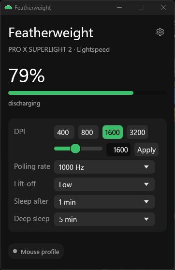
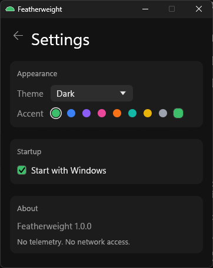

# Featherweight

A tiny, no-telemetry Windows tool for the Logitech G Pro X Superlight 2 (Lightspeed), as a G HUB alternative.

> [!WARNING]
> Only tested with the PRO X SUPERLIGHT 2 on its Lightspeed receiver (and the wired cable for charging
> status). Other Logitech mice may partly work but are untested. Use at your own risk: "Save to mouse"
> writes to the mouse's onboard memory (a backup is made before every write). Not affiliated with or
> endorsed by Logitech.





## Features

- Battery percentage and charging status
- DPI (with the mouse's real DPI steps) and lift-off distance
- Polling rate, including 2000, 4000 and 8000 Hz
- Sleep-after and deep-sleep timers
- "Save to mouse" stores the settings in the mouse's onboard profile
- Tray icon with a live battery gauge
- Start with Windows
- Light/dark theme and accent colour
- Tiny footprint: about 3 MB RAM while hidden in the tray, no network access, no background
  services, no telemetry, no auto-update

## Install

1. Download `featherweight.exe` from [Releases](../../releases).
2. Put it anywhere you like and run it.

The exe is unsigned, so Windows SmartScreen may warn. Click **More info** and then **Run anyway**.
Close G HUB or other Logitech software first, because it can conflict with direct HID++ access.

## How it works

The mouse has two kinds of settings:

- **App settings active (host mode)** — changes to DPI, polling rate, lift-off and sleep timers
  are applied live by the app. They are not stored in the mouse and revert when you switch back
  to the mouse profile.
- **Mouse profile (onboard mode)** — the values stored in the mouse's own memory, which the mouse
  uses on its own.

**Save to mouse** writes the current values into the mouse's onboard profile. It takes a raw
backup of the profile sector before writing and verifies the write byte-for-byte. To go back to
the stored profile without saving, use **Back to mouse profile**.

## Restoring a profile backup

Every save writes a timestamped raw backup to a `backups` folder in the current working directory.
If something goes wrong, restore sector 0x0001 with the CLI:

```powershell
gpx-tool.exe restore-sector backups\profile-YYYYMMDD-HHMMSS-sector0001.bin --yes
```

`gpx-tool.exe profile-dump` makes a read-only dump of all profile sectors.

## Command-line tool

`gpx-tool.exe` is built next to the GUI and provides these commands:

- `status`, `ranges`, `rate`, `devices`, `features`, `feature-info`, `battery-watch` —
  read-only device information.
- `set-dpi <dpi>`, `set-rate <hz>`, `set-lod <1|2|3>`, `onboard` — apply settings live in
  host mode, or return to the mouse's onboard profile (no onboard write).
- `sleep-timers` — read the sleep and deep-sleep timers from the onboard profile.
- `profile-dump` — read-only dump of all profile sectors to `backups`.
- `save-to-mouse [<dpi>] [--dpi N] [--lod 1|2|3] [--rate HZ] [--sleep SECONDS]
  [--deep-sleep SECONDS] --yes` (alias `save-dpi`) — **writes to the mouse's onboard
  profile**; a timestamped backup is made first.
- `restore-sector <file> --yes` — **writes a raw sector backup back to the mouse**.

## Building from source

Requirements:

- [rustup](https://rustup.rs/) with the stable MSVC toolchain
- Visual Studio Build Tools with the "Desktop development with C++" workload
- Windows 11 (the code targets `x86_64-pc-windows-msvc`)

```powershell
cargo build --release
```

The executables are written to:

- `target\release\featherweight.exe` — the GUI/tray app
- `target\release\gpx-tool.exe` — the command-line tool

## Credits

The HID++ protocol documentation and research from
[Solaar](https://github.com/pwr-Solaar/Solaar) and
[libratbag](https://github.com/libratbag/libratbag), plus the public
[OpenLogi](https://github.com/AprilNEA/OpenLogi) documentation, made this project possible.

## Licence

MIT. See [LICENSE](LICENSE).
